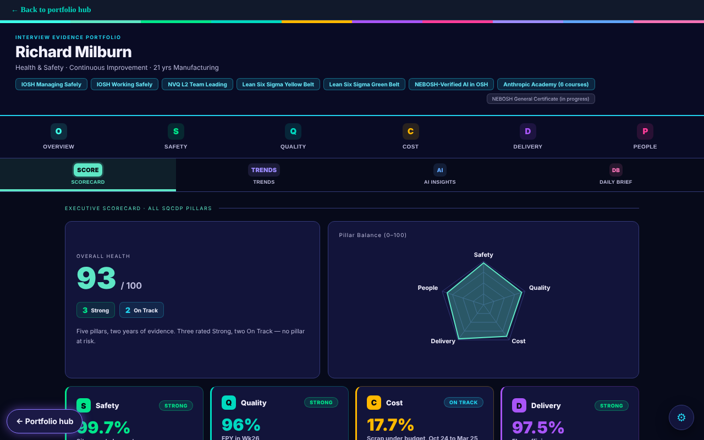

# SQCDP Interview Evidence Dashboard

[Try it live](https://rmilburn1980.github.io/sqcdp-dashboard/) · [Portfolio hub](https://rmilburn1980.github.io/)

Live: https://rmilburn1980.github.io/sqcdp-dashboard/

Interview evidence organised on the SQCDP framework: Safety, Quality, Cost, Delivery and People. Each pillar has headline figures, a short narrative of what I did, and the actions still open. A scorecard radar compares the pillars.

It is a single HTML page with no build step and no server. Data stays in your browser.

## About the figures

The figures in this project are my own. They come from my CV, an export of the SafetyCube incident log (April 2025 to March 2026) and my line performance tracker (August 2023 to July 2025). Where a figure rests on my own records and has not been independently checked, the page says so. Person-level skills detail is illustrative and names are anonymised. Nothing here is a statement that any process, site or person is safe or compliant.

Part of my portfolio: https://rmilburn1980.github.io/
